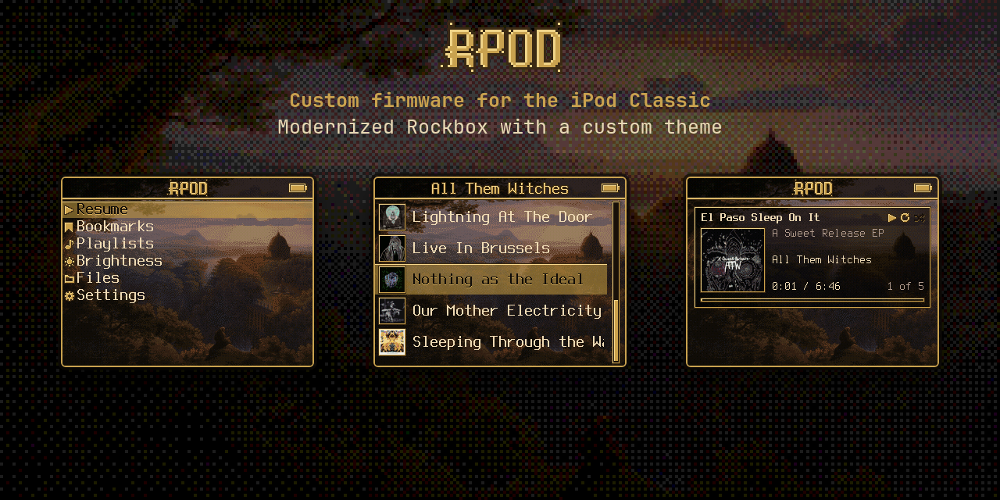

RPod is the Rockbox fork I wanted for my iPod Classic. On top of stock Rockbox:

- Album covers while browsing
- Files and Playlists that open where you expect
- A sleep timer
- One custom theme, Hermit

## The look


- **Album covers while browsing.** Open an artist and every album shows up with its cover, so you
  pick by sight. Stock Rockbox and its themes only show covers on Now Playing.
- **The backdrop.** A Karl Friedrich Schinkel landscape, dithered for the iPod screen, behind every
  menu. It also fills the boot and shutdown screens.
- **Gold.** Icons drawn pixel by pixel, and menu titles in the style of the logo.
- **The selection.** A see-through gold row with letterpressed text, so the backdrop shows through.
- **Now Playing.** One gold panel: song, cover, album, artist, time and a thin progress bar. While
  music plays, the menus keep a small player under the list.

## What changed from stock Rockbox

About 1,100 lines of C on top of stock Rockbox. Release by release: `CHANGELOG.md`.

**Browsing**
- Album cards: open an artist under `/Artists` and every album shows as a card with its cover and
  name. An album without art gets a default card. Only the rows on screen load their cover, and a few
  stay cached. "All Songs" is pinned first.
- Bookmarks as cards: cover, book name and time.
- Files: a gold icon for every kind of file. A playlist opened here shows its songs, and play
  starts from the song you pick.
- Files and Playlists from the main menu always open at the top, never in the last folder or
  playlist you were in.
- Every song in a playlist has the note icon.

**Menus**
- Main menu, Settings and the Now Playing menu trimmed to six items each, with the icons lined up
  row by row across them.
- Sleep in the Now Playing menu: 15, 30 or 60 minutes, or End of track, which pauses when the
  current file ends (one file per chapter makes it "end of chapter" for audiobooks).
- Brightness gets its own shortcut folder: Low, Mid, Max.
- Repeat is Off, All or One. A-B repeat and repeat-shuffle are gone.
- Shorter menu names through a custom language file.

**Volume**
- Volume reads 0 to 100, in even steps: every click moves it the same amount.
- The volume bar is full at 100.
- The volume limit is fixed at 0 dB. Above that, Rockbox pushes the output into distortion.

**Small things**
- Song titles on screen drop remaster notes: "Song (2011 Remaster)" shows "Song". Files and tags
  stay as they are.
- A line still scrolling from the previous screen stops before the next one draws.
- The selected row keeps its highlight after the list wraps around.

## Install

> **Use at your own risk.** iPod drives and music databases are fragile: an interrupted copy, an unclean unplug or a bad firmware can corrupt the database or the
> drive. Back up your music and your `.rockbox` folder before installing.
>
> **Every time you copy anything onto the iPod** (the zip, covers, music), eject it properly and
> wait until it is fully unmounted before you unplug. On Linux: `sync`, then
> `udisksctl unmount -b /dev/sdX1`. Pulling the cable mid-write is the most common way to corrupt it.

One zip, everything in it: the RPod firmware, codecs, plugins, the theme, fonts and language,
set up to boot straight into the RPod look and menus. Sound settings stay at Rockbox defaults.

1. **First time on Rockbox?** Install the Rockbox bootloader once with
   [Rockbox Utility](https://www.rockbox.org/wiki/RockboxUtility), the official installer. Already
   running Rockbox: skip this.
2. Download `rpod-ipod6g-<date>.zip` from
   [Releases](https://github.com/remigius-labs/rpod/releases).
3. Plug in the iPod, unzip onto it so the `.rockbox` folder lands at the top of the drive, eject.

The zip writes over the iPod's `.rockbox` folder, settings included, so back it up first if you have
one. Your music is untouched, and so is the bootloader.

### Album covers

The covers come from small thumbnails in each album folder, in three sizes: 32x32 for the album
rows, 56x56 for the player under the menus and 80x80 for Now Playing. `tools/make-thumbs.sh` makes
all three from the album's `cover.jpg` (or `folder.jpg`, `front.jpg`), or else from the first
song's embedded art. Albums are expected as `Artists/<artist>/<album>/`. It runs on Linux and macOS
and needs ImageMagick and ffmpeg.

```sh
# make the thumbnails in a staging folder; nothing on the iPod is touched yet
tools/make-thumbs.sh /path/to/IPOD/Artists ~/rpod-thumbs
# copy only the thumbnails onto the iPod
rsync -rtm --include='*/' --include='cover.*x*.bmp' --exclude='*' ~/rpod-thumbs/ /path/to/IPOD/Artists/
# eject properly before unplugging
sync && udisksctl unmount -b /dev/sdX1
```

Albums it finds no art for are listed in `~/rpod-thumbs/no-art.txt`.

## Build the firmware

The patch applies to Rockbox commit `59cc0282ec38919e22b7448d0f24c0713da4c21e`.

```sh
git clone https://git.rockbox.org/cgit/rockbox.git
cd rockbox
git checkout 59cc0282ec38919e22b7448d0f24c0713da4c21e
git apply ../rpod/firmware/rpod.patch
# ARM toolchain: tools/rockboxdev.sh, then:
mkdir build-ipod6g && cd build-ipod6g
../tools/configure --target=29 --type=n
make -j8 && make zip
```

The custom language file (shorter menu names) builds with `make $PWD/apps/lang/remi.lng` inside the
build folder; a prebuilt one is in `theme/.rockbox/langs/`.

## Tools

Design tools used to make the theme, in `tools/`. They expect a Rockbox simulator build; set
`RPOD_SIM` to its folder (default `../../rockbox/build-sim`).

- `icons.py`, `usb-medallion.py`, `mock.py`, `rbfont.py`: icon set, USB screen, offline screen mocks
  drawn with the real Rockbox fonts.
- `make-thumbs.sh`: the album cover thumbnails.
- `make-release.sh`: builds the one-zip release from a firmware build.
- `take.sh`: records a scripted run through the simulator in a hidden X display (the GIF above).

## Limits

- RPod is built for my own iPods and shared for anyone curious. The release zip has only been used
  on my own devices and is untested as a fresh install, so back up first and use it at your own risk.
- Built and tested on the iPod Classic 7th gen (Rockbox target ipod6g), 320x240 only.
- Albums split into CD 1 / CD 2 folders do not show a cover in the album rows yet.
- The theme's colours are tuned for the iPod screen; the simulator looks brighter.

## License

- Firmware patch and tools: GPL-2.0, like Rockbox (see `LICENSE`).
- Theme: CC BY-SA 3.0, starting from PodOne, a theme by Guillaume Cocatre-Zilgien (see `theme/LICENSE`).
- The backdrop is a painting by Karl Friedrich Schinkel (1781-1841), public domain.
- Fonts in the release zip: Terminus by Dimitar Toshkov Zhekov (SIL Open Font License 1.1) and
  Nimbus (public domain), both from the Rockbox font pack (see `theme/FONTS.txt`).
